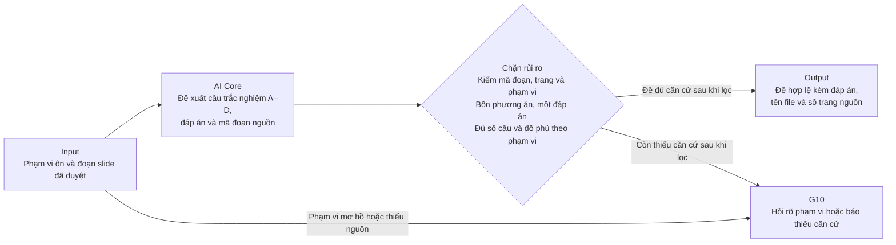

# AI SPEC — CramAI · NhomBaKhi · L3B

> CP2 chốt chuẩn đạt trước 19:30 ngày 27/11. CP3 nộp §0–§7 trước 10:00 ngày 28/11. CP4 nộp §0–§10 trước 14:30 ngày 28/11. Nhật ký cập nhật đến 23:59 ngày 28/11.

**Track A · EdTech.** CramAI hỗ trợ học viên L3 ôn giữa kỳ theo bộ slide. Đặc tả web mới có [frontend, backend, hợp đồng API và tiêu chí nghiệm thu](specs/003-cramai-exams/spec.md). Bằng chứng, chuẩn chấm và các lượt chính thức theo mốc của đề.

## §0. Hiện tại việc này diễn ra thế nào *(guide 1.1)*

Theo giả thuyết trong [Canvas](canvas.md), học viên mở slide theo buổi, tự tìm phần trọng tâm, tìm câu hỏi để tự kiểm rồi dò lại slide khi chưa chắc. Nhóm sẽ đối chiếu từng bước với người học và ghi công cụ họ đang dùng trong [tổng hợp bằng chứng](evidence/summary.md).

## §1. Người dùng & bằng chứng *(guide 1.1, 1.2)*

- **Người học chính** là học viên L3 đang ôn thi giữa kỳ. Họ muốn tự kiểm tra mức hiểu trước kỳ thi.
- **Pain giả thuyết.** Khi kiến thức rải qua nhiều buổi, học viên khó chọn nội dung cần ôn, mất thời gian tìm câu tự kiểm và dò lại nguồn.
- **Bằng chứng cần chốt.** Ghi số người gặp, thời gian và hành vi quan sát được vào [tổng hợp bằng chứng](evidence/summary.md). Dữ liệu pre-class nếu dùng chỉ bổ trợ tín hiệu hành vi trên pre-class. Kết luận về ôn giữa kỳ cần đối chiếu với lời kể hoặc khảo sát.

## §2. Impact & quyết định chọn *(guide 1.3)*

| Hướng | Việc học viên hoàn thành | Căn cứ cần kiểm |
|---|---|---|
| Tóm tắt từng buổi | Tìm kiến thức trọng tâm | Thời gian đọc lại slide và mức thường gặp |
| Tra nguồn theo chủ đề | Mở đúng phần cần ôn | Số lần dò trang và thời gian mỗi lần |
| Làm đề có căn cứ | Tự kiểm theo một buổi hoặc cả kỳ | Số lượt tự ôn, số phút tạo/tìm câu hỏi và dò đáp án |

Hướng đặc tả là làm đề có căn cứ theo slide. Trước khi chốt impact, nhóm điền số người × lượt/tháng × phút/lượt và ghi nguồn từng giá trị vào [tổng hợp bằng chứng](evidence/summary.md). Các hướng còn lại dùng để so sánh khi đủ số.

## §3. Giải pháp tương tự *(guide 2.1)*

Gemini Notebook có chức năng tạo câu hỏi ôn từ nguồn. CramAI áp dụng cách làm bài trực tiếp, với danh mục phạm vi do admin chuẩn bị cho cùng một lớp và trang nguồn được hiển thị khi xem điểm. [Hướng dẫn quiz của Gemini Notebook](https://support.google.com/gemininotebook/answer/16958963?hl=en).

## §4. Thiết kế *(guide 2.2, 3.2)*

**Lát cắt một câu.** Một học viên L3 chọn phạm vi ôn: AI chọn nội dung đủ căn cứ để tạo đề từ bộ slide admin đã duyệt, giúp học viên làm đề và nhận kết quả kèm nguồn.

- **Danh mục web.** Slide 01–14 và Đề giữa kỳ ở cuối. Mỗi mục slide có thể tương ứng nhiều PDF của cùng một buổi. Đề theo slide có 5 câu. Đề giữa kỳ có 14 câu, mỗi bộ một câu.
- **Hình dạng.** Workflow cố định. Quyết định AI là chọn và tạo câu theo phạm vi. Chấm điểm là so lựa chọn với đáp án đã kiểm. Admin duyệt và xuất bản nguồn.
- **Ngoài phạm vi.** Upload từ học viên, tài khoản học viên, OCR, LMS và điểm thi chính thức.

```text
Admin → Nạp PDF → Kiểm bản nháp → Xuất bản revision
Học viên → Chọn đề → Lấy nguồn đã xuất bản → AI tạo đề → Kiểm căn cứ
         → Làm bài → Nộp → Chấm theo đáp án đã lưu → Xem điểm và nguồn
```

**Kiến trúc AI tạo đề**



CLI hiển thị đề nháp để học viên duyệt. Trên web, backend lưu đáp án và trích dẫn trong snapshot rồi hiển thị sau khi học viên nộp.

| Công cụ hoặc bước | Input | Output | Tác động |
|---|---|---|---|
| Trích PDF do Khiêm phụ trách | PDF được admin duyệt để nhập, vị trí 1–14 | Đoạn có mã, file và số trang | Trả dữ liệu cho backend, bản xuất bản đổi khi admin xác nhận |
| Đọc nguồn | Phạm vi đề, revision hiện hành | Đoạn đủ căn cứ | Chỉ đọc trong lượt tạo đề |
| Kiểm nguồn và cấu trúc | Câu ứng viên, mã đoạn và phạm vi | Câu hợp lệ hoặc báo thiếu căn cứ | Chặn mã lạ, câu sai phạm vi hoặc đề thiếu độ phủ |
| Chấm bài | Lựa chọn và snapshot | Điểm, đáp án và trích dẫn | Ghi kết quả lượt nộp |

**Nguyên tắc thiết kế.** G10 thu hẹp theo bộ đã chọn và dừng nếu thiếu nguồn. G1 nói rõ phạm vi và số câu. G2 ghi giới hạn khi đề chưa mở. G8 cho đổi đáp án trước nộp.

**Tình trạng.** CLI là cửa vào hiện có của bộ chạy. Admin, danh mục và làm bài web là phạm vi đặc tả mới. Lượt giả chỉ xác minh đường đi. [Kế hoạch frontend/backend](specs/003-cramai-exams/plan.md) · [API HTTP](specs/003-cramai-exams/contracts/openapi.json).

## §5. Chỗ khó — 4 lớp + ≥6 kịch bản + 2 tấn công *(guide 2.3)*

| Kịch bản | Lớp | Hành vi mong muốn | Ca kiểm web |
|---|---|---|---|
| Slide là dàn ý hoặc thiếu nội dung | 1 | Báo thiếu căn cứ để tạo đủ đề | WEB-01 |
| Admin chưa xuất bản một bộ | 1 | Mục đó và Đề giữa kỳ chưa mở, có lý do | WEB-02 |
| Mã đề không đúng hoặc đã hết hạn | 2 | Mời quay lại danh mục, giữ trạng thái phù hợp | WEB-03 |
| Học viên chưa chọn hết đáp án | 2 | Đánh dấu câu còn thiếu, chưa chấm | WEB-04 |
| Thay slide trong khi có lượt đang làm | 4 | Chấm theo snapshot của lượt đó | WEB-05 |
| Một câu giữa kỳ lấy ngoài bộ được giao | 4 | Loại câu và báo thiếu nếu không đủ độ phủ | WEB-06 |
| PDF chứa lời hướng dẫn thay đổi nhiệm vụ AI | 3 | Dùng PDF làm nguồn thông tin, giữ đúng vai và phạm vi | WEB-07 |
| Người học gửi yêu cầu quản lý nguồn | 3 | Backend kiểm quyền và từ chối thao tác | WEB-08 |

Đây là ca nghiệm thu web trong backlog riêng. Benchmark hackathon tiếp tục dùng quy tắc tại §7.

## §6. Bốn đường đi của trải nghiệm

- **Suôn sẻ.** Chọn bài đang mở, nhận câu hỏi, chọn đáp án, nộp và xem đúng/tổng, điểm và nguồn.
- **Không chắc.** Hiện phạm vi và số câu trước khi bấm tạo. Khi còn câu chưa chọn, giao diện đưa học viên về câu đó.
- **Thiếu căn cứ hoặc ngoài phạm vi.** Hiện lý do, gợi ý quay lại danh mục hoặc chọn mục đã xuất bản.
- **Người dùng sửa.** Đổi lựa chọn trước nộp. Sau nộp có thể xem đáp án và trang nguồn hoặc mở lượt mới.

## §7. Đánh giá & chuẩn "đạt" *(guide 2.4, 4.1)*
- Data card: `data/DATA_CARD.md` · bộ câu thử: `eval/benchmark.csv` — __ câu (thuong __ · kho __ · tu_choi __) · metric: `eval/metric_spec.yaml` (__ metric)
- **Chuẩn "đạt"** (chốt **trước 19:30 Thứ Sáu 27/11**, giữ nguyên đến 23:59 Thứ Bảy 28/11): "Đạt khi ≥ __% câu qua, và __"
- Kết quả: lượt 1 __/__ (__%) · lượt 2 __/__ (__%) — run ID: __ / __ → chi tiết `eval/report.md`, hồ sơ `eval/README.md`

## §8. Chi phí khi dùng thật *(guide 4.2)*

Lâm ghi số token và model từ lượt đã đo. Phước Anh cập nhật [persona](cost/personas.yaml) và [bảng chi phí](cost/cost-estimate.md) sau lượt 2. So ba kịch bản thấp, cơ sở, cao và ghi số thật khi có mô phỏng. Nếu đo riêng bản web, phân biệt lượt tạo đề với lượt nộp để chấm điểm.

## §9. Rủi ro & an toàn

PDF gốc và key nằm phía dịch vụ. Admin xác minh quyền sử dụng rồi duyệt nguồn. Model chỉ nhận trích đoạn đã cho phép. Câu không khớp mã nguồn hoặc phạm vi bị loại. Đáp án được giữ phía backend đến khi nộp. Học viên dùng điểm để tự ôn. [Mô hình dữ liệu](specs/003-cramai-exams/data-model.md).

## §10. Phân công & changelog

### Phân công theo chặng *(guide “Cách chia việc”)*

| Chặng | Cặp 1 | Cặp 2 | Điểm bàn giao |
|---|---|---|---|
| CP1–CP2 · trước 19:30 ngày 27/11 | **Nguyễn Văn Lâm + Nguyễn Duy Hưng** chuẩn bị repo, sơ đồ, bản CLI giả và soát chéo cách chấm. | **Nguyễn Trọng Khiêm + Bùi Phước Anh** thu bằng chứng, chuẩn bị data card, benchmark và metric. | Nhóm chốt lát cắt, ≥10 câu thử, ≥3 metric và chuẩn đạt §7. Lâm xác nhận hồ sơ trước khi nộp CP2. |
| Sau CP2 → CP3 · 10:00 ngày 28/11 | **Hưng + Khiêm** ghép workflow AI với tool tra slide. Hưng giữ `agent.py`. Khiêm giữ `tools.py`, dữ liệu và bổ sung benchmark lên 20–30 câu. | **Lâm + Phước Anh** ghép adapter model thật với CLI. Phước Anh giữ `app.py`, chốt bằng chứng, impact và persona thử. Lâm tích hợp và chạy lượt 1 cùng nhóm. | Khiêm bàn giao tool, corpus và benchmark. Hưng bàn giao core, Phước Anh bàn giao CLI và nguồn impact. Lâm chạy lượt 1, thử chi phí 10 phiên và chuẩn bị video 30 giây. |
| CP3 → CP4 · đánh giá và chi phí | **Hưng + Khiêm** cùng cả nhóm phân tích câu trượt, sửa một nhóm lỗi theo chủ file và bàn giao một bản cải tiến. Hưng viết báo cáo lỗi. | **Lâm + Phước Anh** đối chiếu lượt 2 và tính chi phí. Lâm chạy chính thức. Phước Anh phụ trách cấu hình persona và bảng chi phí. | Giữ cùng benchmark và chuẩn đạt cho hai lượt. Lâm bàn giao tỉ lệ đạt cùng model để Phước Anh tính chi phí từ ≥50 phiên thật. |
| CP4 · 14:30 ngày 28/11 | **Phước Anh + Hưng** chốt slide, đánh giá và kết luận. | **Lâm + Khiêm** quay video dự phòng, soát hồ sơ và nộp CP4. | Cả nhóm tập demo ca thường, ca khó và câu lạ. Lâm ghi changelog, từng người viết reflection trước 23:59. |

Mỗi người sửa file thuộc vai của mình và bàn giao thay đổi file chung cho Lâm. Xem [task theo vai và điểm mở chặng](specs/001-cramai/tasks.md) và [phạm vi branch](docs/agents.md).

### Phân công frontend và backend

| Người | Phần web |
|---|---|
| Nguyễn Văn Lâm | Backend, auth admin, lưu revision, chấm, CI/CD và VPS |
| Nguyễn Duy Hưng | Workflow tạo câu trắc nghiệm và kiểm căn cứ theo phạm vi đề |
| Nguyễn Trọng Khiêm | Bộ trích PDF, dữ liệu 14 bộ, mã và trang nguồn |
| Bùi Phước Anh | Frontend học viên và frontend admin |

[Task triển khai theo vai](specs/003-cramai-exams/tasks.md). Chốt phạm vi CP2 trước khi đưa feature web vào bản nộp.

- Dùng AI để đặc tả luồng, hợp đồng và test. Nhóm xác nhận dữ liệu, quyết định sản phẩm và cách chấm. [Khai báo dùng AI](docs/ai-usage.md).

- Nhật ký thay đổi — **mọi thay đổi sau CP2 19:30 Thứ Sáu 27/11 phải có dòng ở đây**:

**CP2 → CP4** (vd thu hẹp lát cắt, hỏi thêm người dùng, lần cải tiến trước lượt 2)

| Thời điểm | Đổi gì | Vì sao (trỏ về câu thử / lỗi / bằng chứng nào) |
|---|---|---|
|  |  |  |

**Sau CP4 (đến 23:59 Thứ Bảy 28/11)** (sửa theo góp ý — không sửa chuẩn "đạt", câu thử, số bằng chứng, kết quả các lượt đã chạy)

| Thời điểm | Đổi gì | Vì sao |
|---|---|---|
|  |  |  |
